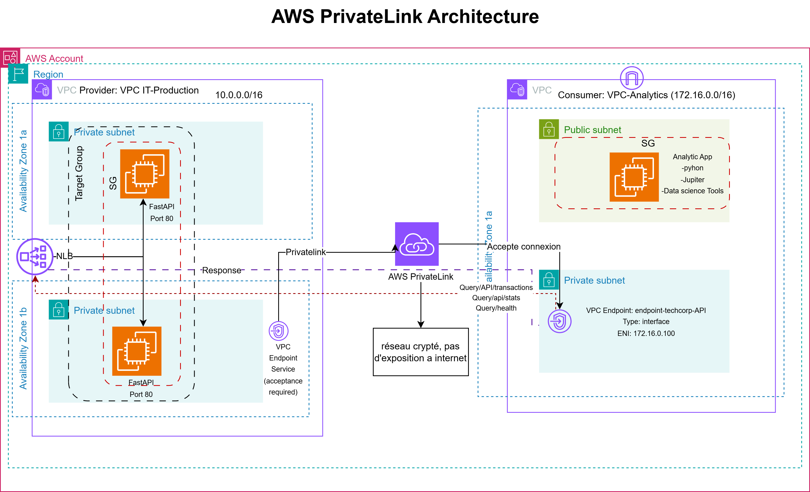

# PrivateLink-Infra

This repository contains Terraform configuration to deploy a small AWS PrivateLink demo environment (provider VPC + consumer VPC, Network Load Balancer, EC2 instances, VPC Endpoint Service).

## Purpose
- Deploy a minimal AWS architecture that demonstrates exposing a service using AWS PrivateLink (NLB backed service + VPC Endpoint Service) and a client instance in a consumer VPC that calls the service.

## Architecture


A client instance in the consumer VPC calls the API through an interface VPC endpoint. The endpoint connects to the endpoint service, which fronts a Network Load Balancer. The NLB distributes traffic to two API instances in private subnets of the provider VPC. There is no peering or route between the two VPCs.

## Repository layout
- `*.tf`: Terraform configuration files (VPCs, security groups, NLB, endpoint service, EC2, IAM, CloudWatch).
- `scripts/`: user-data scripts for instances (`api-server-userdata.sh`, `analytics-userdata.sh`).
- `terraform.tfvars`: environment-specific variable values (do not commit secrets).
- `CHANGELOG.md`: recent fixes and notes.

## Prerequisites
- Terraform 1.0 or newer installed
- AWS credentials configured (environment, shared `~/.aws/credentials`, or set `aws_profile` in `terraform.tfvars`)

## Quick start (PowerShell)
```powershell
cd 'C:\Users\EAZYTraining\Documents\PrivateLink-Infra'
terraform fmt -recursive
terraform init
terraform validate
terraform plan -var-file="terraform.tfvars"
# If the plan looks good:
terraform apply -var-file="terraform.tfvars"
```

## Testing the infrastructure
After `terraform apply`, read the values you need:
```bash
terraform output
```

1. **Check the endpoint state.** `endpoint_state` must be `available`.

2. **Check target health.** Both API instances must be `healthy`. `initial` is normal for 2-3 minutes after deployment.
   ```bash
   aws elbv2 describe-target-health --target-group-arn "$(terraform output -raw nlb_target_group_arn)"
   ```

3. **Test the service through PrivateLink.** Connect to the analytics instance (`analytics_instance_public_ip`) over SSH, then run the command from the `test_command` output:
   ```bash
   curl -s http://<endpoint_dns_name>/health
   curl -s http://<endpoint_dns_name>/api/transactions
   ```
   A JSON response confirms the path analytics -> endpoint -> endpoint service -> NLB -> API works.

4. **Check the isolation.** From the analytics instance, call a private IP of an API instance directly. It must time out, because the VPCs are not connected except through PrivateLink:
   ```bash
   curl -m 5 http://<api-private-ip>/health
   ```

### Troubleshooting
- Targets `unhealthy` or `initial`: on an API instance, check `systemctl status techcorp-api` and `tail /var/log/user-data.log` (use SSM Session Manager, the instances are in private subnets).
- Timeout on the endpoint DNS name: check that the endpoint security group allows port 80 from the consumer subnet.
- Connection not accepted: in VPC > Endpoint services > Endpoint connections, accept the pending connection.
- `OperationNotPermitted` when creating the load balancer: the AWS account cannot create ELBs. Contact AWS Support or use another account.

## Security notes
- `my_ip` in `terraform.tfvars` defaults to `0.0.0.0/0` for convenience during testing — change this to a restricted management CIDR (for example `203.0.113.4/32`) before applying in production.
- Terraform state files (`terraform.tfstate`, `terraform.tfstate.backup`) and `terraform.tfvars` may contain sensitive data and should not be committed. `.gitignore` already includes common patterns; if state files were previously committed, remove them from the Git index with `git rm --cached <file>` and commit.
- The example API user-data (`scripts/api-server-userdata.sh`) runs a simple Flask app as `root` on port 80. For production, run services under a non-root user and harden the instance (firewall rules, monitoring, regular package updates).

## Customization
- `variables.tf` exposes options such as instance types, provider/consumer VPC CIDRs, and toggles for VPC Flow Logs and endpoint acceptance. Update `terraform.tfvars` to match your environment.


